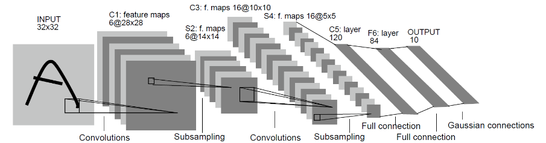

# 课程原题 · 手写数字识别与垃圾分类

这是一道包含代码和实验报告的实训题。先用 MindSpore 和 LeNet5 完成 0–9 手写数字识别，再用 MobileNetV2 识别 26 种垃圾。两份实验 Notebook 直接取自课程发放的 `垃圾分类.zip`，保留了初始代码、注释和空输出。题面来自课程实训页。[题面全文](assignment.txt) · [Mo 原题](https://mo.zju.edu.cn/competition/detail?type=practice&paperId=6ae994799de7db84111b29e1&courseId=6aa55443ace337cd9b662556&sectionId=6ae00c84b9499f8f910a8042) · [课程作业目录](https://mo.zju.edu.cn/classroom/class/zju_ai_sys?activeKey=courseAssignment)

## 建议阅读顺序

| 顺序 | 打开 | 可以学到什么 |
| --- | --- | --- |
| 1 | [手写数字识别 Notebook](lenet_mnist.ipynb) | 加载 MNIST，定义 LeNet5，训练后加载权重，查看预测的数字 |
| 2 | [垃圾分类 Notebook](main.ipynb) | 查看样图和学习率曲线，提取特征，训练分类头，再阅读第 5 节的评分接口 |
| 3 | [26 类中英文标签](labels.md) | 把数据目录、模型输出索引和英文类别名对应起来 |
| 4 | [平台测试与提交指南](testing_guide.ipynb) | 对照课程说明，了解生成 `main.py`、系统测试和正式提交的顺序 |

对应的 Python 脚本也来自原包。[手写数字训练脚本](lenet_mnist.py) · [垃圾分类训练脚本](train_main.py) · [数据加载代码](src_mindspore/dataset.py) · [网络定义](src_mindspore/mobilenetv2.py)

## 在本地运行原题

从仓库根目录进入第一题，创建并激活 Python 3.11 虚拟环境，然后打开课程 Notebook。如果已创建环境，可以跳过创建步骤。

```bash
cd 01-image-classification
python3.11 -m venv .venv
source .venv/bin/activate
python -m pip install -r course_original/requirements.txt
cd course_original
jupyter lab
```

在 Mo 题面进入自己的工作区，取课程数据和预训练权重，按下表放到本目录。实验使用相对路径，请在 `course_original/` 中打开 Notebook。[Mo 原题](https://mo.zju.edu.cn/competition/detail?type=practice&paperId=6ae994799de7db84111b29e1&courseId=6aa55443ace337cd9b662556&sectionId=6ae00c84b9499f8f910a8042)

| 相对于本目录的路径 | 内容 |
| --- | --- |
| `datasets/5fbdf571c06d3433df85ac65-momodel/MNIST/` | `train/` 和 `test/` 下放未压缩的 IDX 图像、标签文件。课程版是 60,000 张训练图、10,000 张测试图 |
| `datasets/5fbdf571c06d3433df85ac65-momodel/garbage_26x100/` | 放入 `train/` 和 `val/`，共 2,343 张训练图、130 张验证图。[原包 label.txt](datasets/5fbdf571c06d3433df85ac65-momodel/garbage_26x100/label.txt) 已收录 |
| `src_mindspore/mobilenetv2-200_1067_cpu_gpu.ckpt` | 课程提供的预训练骨干。此处按实际附件和 Notebook 的配置写文件名 |

垃圾分类原版默认加载自己训练出的 `./results/ckpt_mobilenetv2/mobilenetv2-4.ckpt`。如果只想体验仓库作者训练的最终权重，可以跳过原版训练，直接运行[第一题的预测示例](../README.md#运行一次预测)。

### 原版样例中的变量名

垃圾分类 Notebook 最后一段测试代码把图片读入 `image`，随后却调用 `predict(image_rgb)`。如果报 `NameError`，可以在第 5 节模型加载完成后新建一个单元格，直接传入刚读入的 RGB 数组。

```python
from PIL import Image
import numpy as np

path = "./datasets/5fbdf571c06d3433df85ac65-momodel/garbage_26x100/val/00_01/00037.jpg"
with Image.open(path) as photo:
    image = np.array(photo.convert("RGB"))
print(predict(image))
```

原题要求 `predict(image)` 接收形状为 `(H, W, 3)` 的数组，返回课程规定的英文类别名。代码以外，课程还要求提交实验报告。[原题评分说明](main.ipynb) · [完整题面](assignment.txt)

## 课程配图

下面是手写数字 Notebook 引用的 LeNet5 结构图。截图同样采用课程原指南的图片，便于离线阅读。[课程图源](https://imgbed.momodel.cn/lenet5.jpg)



[生成评分代码](assets/guide-generate.png) · [预览代码](assets/guide-preview.png) · [选择测试文件](assets/guide-test.png) · [查看测试结果](assets/guide-results.png) · [正式提交界面](assets/guide-submit.png)

课程原包中的《测试提交指南.ipynb》在这里使用英文文件名 `testing_guide.ipynb`。模型定义保留原作者署名和随附许可。[模型源码许可](src_mindspore/LICENSE.txt)

